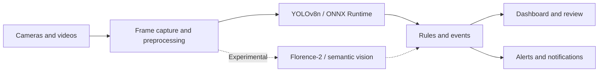

# SurveillanceAI

**Intelligent camera monitoring with local AI.**

[Português (Brasil)](readme.md) | [English](readme.en.md)

**SurveillanceAI** is a Windows desktop application combining video capture, AI-based object detection, configurable monitoring rules, and event management in a single interface. It explores how computer vision can help operators identify situations of interest in retail and other monitored spaces, with **on-device inference** and local control over processing.

The current direction combines the speed of conventional object detectors with the flexibility of text-guided vision models, while keeping the operator experience straightforward.

## Highlights

- **Multi-camera monitoring:** webcams, RTSP IP cameras, compatible HTTP streams, and local video files.
- **Local AI:** object detection through YOLOv8n and ONNX Runtime, with background processing and bounded frame queues.
- **Semantic detection research:** experimental Florence-2 integration for text-guided localization, including possible firearms in surveillance imagery.
- **Events and evidence:** searchable history, operator review, notes, and false-positive classification.
- **Alerts and notifications:** monitoring rules, event cooldowns, and SMTP email delivery.
- **Complete desktop stack:** WPF interface, authentication and user roles, SQLite persistence, Portuguese and English UI, automated tests, and Windows publishing.

## How it works



Frame capture and model inference run independently of the UI. Predictions may include **object class, bounding boxes, and processing information**. The application also captures measurements such as FPS, latency, and dropped frames for local hardware evaluation.

## Core technology glossary

| Technology | What it does | Role in the project |
| --- | --- | --- |
| **YOLOv8n — You Only Look Once** | Detects and localizes objects in a single neural-network pass. | Fast recognition of people and predefined object categories. |
| **ONNX — Open Neural Network Exchange** | Interoperable AI model format. | Enables deployment of exported models without their training stack. |
| **ONNX Runtime** | Optimized inference engine for ONNX models. | Runs detection locally with compatible acceleration options. |
| **Florence-2** | Microsoft's vision foundation model for visual understanding and localization. | Experimental text-guided detection complementary to fixed-class detectors. |
| **Phrase grounding** | Links a text description to a region of an image. | Explores searches such as `handgun` in surveillance frames. |
| **Inference** | Applying a pretrained model to new inputs. | Processes camera images without retraining during execution. |
| **Bounding box** | Rectangle enclosing a predicted object region. | Highlights where an object was detected. |
| **NMS — Non-Maximum Suppression** | Removes redundant detections of the same object. | Improves detector output clarity. |
| **IoU — Intersection over Union** | Measures overlap between regions. | Supports spatial association in monitoring rules. |
| **C# / .NET 10 / WPF / MVVM** | Application platform, desktop UI, and presentation pattern. | Power the application's services and user experience. |
| **SQLite / Entity Framework Core** | Embedded persistence and data access. | Store camera settings, events, and audit records. |
| **MailKit** | Email communication library. | Implements SMTP notification delivery. |

Camera protocols, authentication, credential protection, and lower-level implementation details are covered in the [architecture](docs/en/architecture.md) and [monitoring](docs/en/monitoring.md) guides.

## Roadmap: monitoring templates

The intended experience is to **choose what to monitor** without requiring operators to configure model classes, score thresholds, or temporal rules manually.

| Template | Direction |
| --- | --- |
| **Possible firearms and replicas** | Explore visual recognition regardless of the identity or intent of people in the frame. |
| **Knives and sharp objects** | Identify relevant objects within monitored areas. |
| **Crowding** | Combine people counts with regions of interest and temporal trends. |
| **People running** | Estimate movement from object tracking across frames. |
| **Possible physical confrontation** | Investigate activity patterns and potentially pose estimation. |
| **After-hours movement** | Combine zone monitoring with configurable schedules. |
| **Screams and calls for help** | Explore future local audio-event models. |

The long-term UX is based on templates configurable by **camera, region, and sensitivity**, with advanced settings available when needed. These are development directions, not a claim that every capability has shipped.

## Run locally

**Development requirements:** Windows x64 and .NET 10 SDK.

```powershell
dotnet restore SurveillanceAI.sln
dotnet build SurveillanceAI.sln
dotnet run --project src/SurveillanceAI.Desktop
```

On first launch, the app creates its local database under `%LOCALAPPDATA%/SurveillanceAI/` and guides the operator through administrator setup. Cameras are configured from the interface.

Tests and self-contained Windows publishing:

```powershell
dotnet test SurveillanceAI.sln
dotnet publish src/SurveillanceAI.Desktop -c Release -r win-x64 --self-contained true -o artifacts/publish
```

## Documentation

- [Architecture](docs/en/architecture.md) and [monitoring/models](docs/en/monitoring.md)
- [Validation and testing](docs/en/validation.md)
- [Deployment](docs/en/deployment.md)
- [Internationalization](docs/en/internationalization.md)
- [Security and privacy](docs/en/security.md)

SurveillanceAI is under **active development**. New vision engines and monitoring templates are added and evaluated progressively against realistic images and video. Operational considerations, deployment requirements, and model licensing details belong in the technical documentation.
