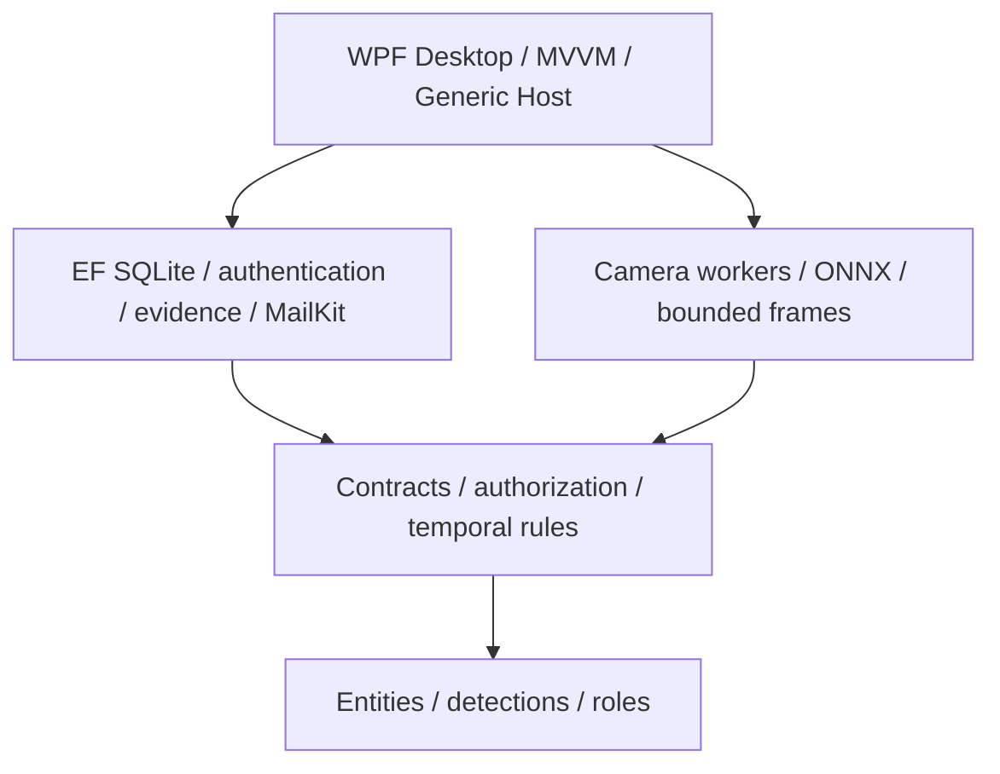

[Português](readme.md) | English

# SurveillanceAI - Windows desktop foundation

A local WPF workspace for real-time camera monitoring, object detection and operator review. This MVP does not predict crime, recognize aggression, or provide a validated weapon detector. Monitoring stops when the desktop process exits.

## Implemented

- .NET 10, WPF, CommunityToolkit.Mvvm and Generic Host; dark navy/slate design, live camera tiles, expanded view and preview pause independent of monitoring.
- First-run administrator creation, Identity-compatible password hashing, login/logout, password changes, three roles, user activation and account lockout.
- EF Core SQLite migrations, camera configuration, paginated/filterable events, review status, notes and audit records. No production incident seed data.
- Independent capture/inference tasks, capacity-one latest-frame buffers, disposal, webcam/RTSP/video sources, reconnect backoff and cancellation.
- Actual CPU ONNX inference with the existing YOLOv8n model, hash verification, versioned class mapping, explicit tensor/score/preprocessing contracts and NMS.
- Disabled-by-default alert rules with spatial association, temporal confirmation and cooldown. Proximity is an optional visual diagnostic only.
- Recipient filters, DPAPI-protected camera sources/SMTP passwords, MailKit, persistent asynchronous delivery attempts/retries and SMTP connection/email tests.
- Optional snapshots, retention cleanup, structured JSON logs, configurable minimum log level and actual monitoring metrics.
- Unit/integration tests, Windows CI, self-contained publish and a repeatable interactive UI smoke script.

## Architecture



The legacy console project has been removed. `SurveillanceAI.Desktop` is the sole executable application; the required ONNX model assets are preserved. See [architecture](docs/en/architecture.md) and [audit](docs/en/audit.md).

## Language

Brazilian Portuguese (pt-BR) is the default, independently of Windows. Use the Idioma / Language selector before or after login to switch live to English (en-US). The choice is saved in language.json under the installation data root. Switching does not restart cameras. Display numbers/dates follow the selected culture; UTC storage, enum codes and model class names stay invariant. See [internationalization](docs/en/internationalization.md).

## Build and initial setup

Use Windows x64 and the .NET 10 SDK. `global.json` accepts the latest .NET 10 feature band. Visual Studio must support that SDK; CLI builds work independently.

```powershell
dotnet restore SurveillanceAI.sln
dotnet build SurveillanceAI.sln
dotnet run --project src/SurveillanceAI.Desktop
```

On this development machine, use `.tools/dotnet/dotnet.exe` if .NET 10 is not on PATH. This locally installed SDK is ignored and is not part of the product.

First launch migrates `%LOCALAPPDATA%/SurveillanceAI/surveillance.db`. Enter a username and a 12-256 character password to create the administrator and sign in. There is no default production password. Only one process can use the same data root at once.

Set `SURVEILLANCEAI_DATA` before launch for an isolated/private local data root outside the repository. This relocates database, evidence and logs together. Stop the application before copying an existing installation. Protected secrets remain tied to the original Windows account.

## Using the workspace

1. **Cameras:** create a camera with name, description, location, source type and FPS (1-30). Use `0` for the default webcam, a full local file path, or an RTSP URI. Sources are visible while entering them and protected at rest; leaving the field blank while editing preserves the saved source. Select `HttpStream` for HTTP/HTTPS streams such as LensCast. Save, then test the connection. Enable/disable and save to start/stop monitoring. Applying configuration restarts configured workers.
2. **Overview & Live:** view camera state, previews, model version, capture/inference FPS, latency, drops, reconnects and queue depth. Expand a camera or pause previews; neither stops inference. Nothing is registered automatically.
3. **Alert rules:** use an exact model class, confidence, confirmations, time window, association IoU, cooldown and severity. Optional camera GUID scopes a rule. Explicitly enable it. Starting values are examples requiring operational validation.
4. **Events:** search class/notes and filter camera, local date range, severity or review status. Displayed event times are UTC. Pages contain up to 100 rows. Operators/admins can record notes, review or mark false positives; viewers cannot change events.
5. **System:** validate and activate trusted local model bundles; configure optional evidence, retention and log level. Evidence lives in the data root's `evidence` subdirectory. Default event/evidence retention is 30 days; logs retain 14 days.
6. **Users / My account:** manage local accounts or change the current password. Service-level authorization enforces roles outside the UI.

## Models

`onnxmodel/yolov8n.onnx` and its checked-in `manifest.json` are packaged into `models/legacy`. Both historical ONNX copies have the same SHA-256; no original models were deleted. The desktop publish excludes duplicate weights and `.pt` files.

Detection bundles contain a manifest and named ONNX file. See [monitoring/model contract](docs/en/monitoring.md). Validate a trusted bundle in System before activation. The app never downloads models.

The inspected training repository Phase 3 exports a ResNet18 classifier, not a detector. That manifest is rejected. A future custom detector needs an agreed export contract and validation; weapon detection is not claimed. No training repository files were modified.

## SMTP

Save host, port, TLS mode, optional username/password, sender and maximum attempts in Notifications. Real servers require `StartTls` or `SslOnConnect`. `LocalTest` permits unencrypted SMTP only on literal loopback addresses. Add enabled recipients with optional class/camera/minimum-severity filters, then explicitly enable the channel.

**Test saved SMTP connection** connects/authenticates without sending. **Send test email** deliberately queues one message even if the general channel is disabled. Both use saved settings. Refresh to inspect attempts and sanitized errors. Normal notifications default to disabled. Messages contain metadata, not footage attachments.

## Tests and publish

```powershell
dotnet test SurveillanceAI.sln
dotnet publish src/SurveillanceAI.Desktop -c Release -r win-x64 --self-contained true -o artifacts/publish
./scripts/Smoke-Desktop.ps1
```

Tests use temporary databases, mock sources, generated MJPEG video, the bundled CPU model, a public Ultralytics sample image and loopback SMTP. No physical camera, GPU, SMTP account or execution-time network is required. The interactive UI smoke script uses an isolated temporary database and only a disabled test camera. Hosted CI builds/tests/publishes; interactive UI smoke is a local check.

See [validation](docs/en/validation.md), [deployment](docs/en/deployment.md), [database](docs/en/database.md) and [security/privacy](docs/en/security.md).

## Technology glossary

This glossary explains how each technology fits into the architecture. Items under evaluation are labeled **planned**, not presented as available features.

| Technology / concept | What it is | Role in SurveillanceAI |
| --- | --- | --- |
| **C# / .NET 10** | Programming language and application platform. | Implement the desktop app, services, processing, and monitoring logic. |
| **WPF** | Windows desktop UI framework. | Displays cameras, configuration, events, and alerts. |
| **MVVM / CommunityToolkit.Mvvm** | UI separation pattern and supporting toolkit. | Structure views and application state. |
| **Generic Host** | .NET infrastructure for dependency injection and hosted services. | Manages service initialization and application lifecycle. |
| **YOLOv8n (You Only Look Once)** | Neural object detector from the YOLO family. | Detects predefined categories such as people and cell phones and produces bounding boxes; validated firearm detection is not part of the current model. |
| **ONNX** | Interoperable machine-learning model format. | Packages inference models independently of their training framework. |
| **ONNX Runtime** | Inference engine for ONNX models. | Runs local detection; the current integration uses CPU. |
| **Inference** | Running a pretrained model on new data. | Analyzes video frames without retraining. |
| **Bounding box** | Rectangle approximating an object's location. | Displays detections and supports event evidence. |
| **Confidence / score** | Model-provided score for a prediction. | Helps filter detections; it is not necessarily a calibrated probability. |
| **NMS (Non-Maximum Suppression)** | Filtering of redundant detection boxes. | Reduces overlapping duplicate detections. |
| **IoU (Intersection over Union)** | Measure of overlap between regions. | Supports existing spatial association, not persistent person tracking. |
| **RTSP** | Network media streaming control protocol. | Connects compatible IP camera streams. |
| **HTTP / MJPEG** | Network delivery of images or video frames. | Supports compatible HTTP streams, including mobile camera feeds. |
| **SQLite / EF Core** | Embedded database and .NET data-access framework. | Store camera settings, events, reviews, and audit data. |
| **DPAPI** | Windows-bound data protection mechanism. | Protects saved credentials and sensitive source values. |
| **MailKit / SMTP** | Email library and sending protocol. | Deliver configured notifications through a persistent queue. |
| **Florence-2 (planned)** | Microsoft's vision foundation model supporting tasks such as text-guided localization. | Candidate local complementary detector for possible weapons; integration and accuracy remain unvalidated. |
| **Phrase grounding (planned)** | Locating image regions that match text descriptions. | Could locate objects described as `handgun` or `revolver`, subject to testing. |
| **Temporal tracking (planned)** | Associating objects across successive frames. | Potential basis for running and crowd-motion analysis; persistent person tracking is not yet implemented. |
| **Audio event classification (future)** | Recognition of sound events. | Could support scream alerts using separate audio input and models; Florence-2 does not process sound. |

## Product direction: monitoring templates

The intended UX for supermarkets, pharmacies, and similar locations is a **camera-specific set of selectable monitoring templates**, rather than exposing class IDs, IoU, and time-window parameters to every operator. **These are roadmap concepts, not validated or completed features.**

| Proposed template | Technical approach | Status |
| --- | --- | --- |
| **Known objects** | Existing YOLOv8n classes and alert-rule infrastructure. | Detection foundation implemented; simplified template UI planned. |
| **Possible firearms and replicas** | Evaluate Florence-2 or another local detector, regardless of a person's identity, intent, or proximity. | Experimental; firearm recognition not validated. |
| **Knives and sharp objects** | Suitable object detection with measured accuracy. | Planned; no specialized capability claimed. |
| **People running** | Person detections plus temporal tracking and displacement. | Planned; running cannot be established from a single still frame. |
| **Unusual crowding** | Person counts, density, zones, and change over time. | Planned; must be calibrated to the location. |
| **Possible physical confrontation** | Temporal activity analysis, potentially pose estimation or action recognition. | Research; proximity alone does not prove a fight. |
| **Screams / calls for help** | Audio capture plus a local sound-event classifier. | Future; requires a separate audio pipeline and model. |
| **After-hours movement** | Motion analysis and configurable schedules. | Proposed template; implementation and testing required. |

**Intended operator experience:** toggle templates, select cameras or regions of interest, and adjust sensitivity. Events can be reviewed and marked as false positives. The software must distinguish **preventive alerts** from **confirmed incidents**.

**Design principles:** local inference where feasible, preservation of the existing ONNX detector, modularity, approachable configuration, and real-world measurement of false positives, misses, and latency before commercial claims. A possible-firearm alert should depend on the suspicious object itself, including when stationary, not on the identity or presumed intent of nearby people.

## Limitations and next release work

- No persistent Windows Service, auto-start, watchdog or 24/7 guarantee.
- IoU association is not persistent identity tracking. Safety, accuracy, false-positive rates and multi-camera hardware capacity are not operationally validated.
- One local interactive session; no MFA, password recovery, per-camera ACLs, database/evidence encryption or tamper-proof audit. Protect the Windows account, disk and data directory.
- Evidence location is selected through the installation data root, not an independent UI folder picker. Expanded camera view is borderless full-screen; Escape returns to the workspace.
- Camera/model configuration application restarts all workers. Native webcam drivers can block despite managed cancellation; physical hardware/RTSP field tests remain necessary.
- SMTP is at-least-once: a crash after send but before recording success can cause a duplicate. Unique event/recipient rows prevent ordinary queue duplication, not that crash window.
- Retention handles tracked events/evidence, not arbitrary power-loss orphan files. Audit archival, video recording, evidence export/legal hold, signed installer and automatic updating are future work.
- Model metadata declares AGPL-3.0. Review all model, sample asset, native codec and dependency licensing before commercialization; no licensing clearance is claimed.

Before a pilot: hardware soak tests, operator review, model/rule validation, privacy/licensing review, backup/restore exercises and signed packaging. Add a persistent host only after its lifecycle, account/key ownership and IPC authorization are tested.

Language-switch/persistence UI smoke: `./scripts/Smoke-Localization.ps1`.
