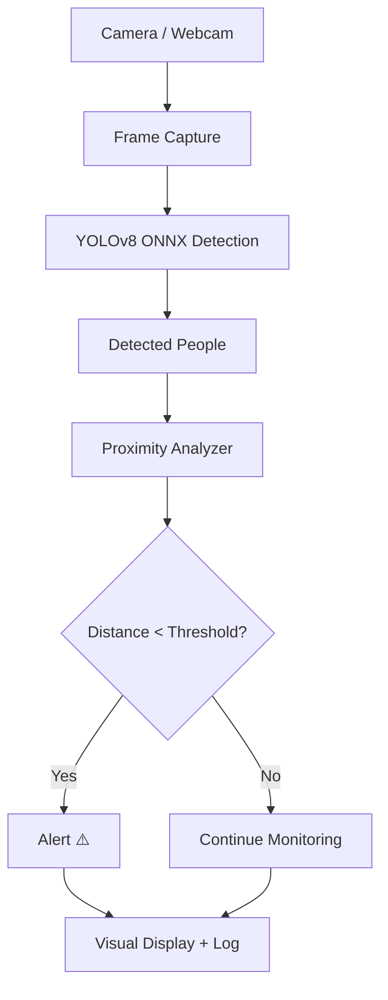

# 🛡️ SurveillanceAI — Intelligent Video Behavior Analysis (v1.0)

## 📌 Overview

**SurveillanceAI** is a real-time computer vision system built with **.NET (C#)**. It analyzes camera footage to identify **potentially concerning interactions between people**, initially focusing on scenarios involving a possible confrontation or robbery.

Unlike traditional solutions based only on object detection, this project introduces a **behavioral** approach that analyzes:

* proximity between individuals
* approach dynamics
* spatial context

---

## 🎯 Objective

Automatically flag potentially dangerous situations in video, such as:

* aggressive approaches between people
* intrusion into personal space
* early patterns of a potentially suspicious approach

---

## ⚙️ Technologies

* **.NET 8 (C#)**
* **OpenCvSharp** → video capture and rendering
* **ONNX Runtime** → AI model inference
* **YOLOv8 (ONNX)** → real-time person detection

---

## 🧠 System Architecture

The system is designed with a clear separation of responsibilities:

| Layer        | Responsibility                       |
| ------------ | ------------------------------------ |
| Detector     | Object detection (YOLO)              |
| Analyzer     | Behavioral logic (proximity)         |
| UI (Program) | Visualization and alerts             |

---

## 🔄 How It Works



---

## 📏 Proximity Logic

For each frame, the system:

1. Identifies all detected people
2. Calculates the distance between each pair
3. Flags close proximity or a critical distance

### Baseline rule (v1.0)

```
IF distance < threshold
→ flag a potentially concerning interaction
```

---

## 🖥️ Visual Output

The system displays:

* 🔴 bounding boxes around people
* 🟡 a line between individuals
* 📏 real-time distance
* ⚠️ a visual alert when proximity is critical

---

## 🔊 Alert System

* Console logs
* Optional audible alert (beep)
* Foundation for integrating external notifications

---

## 🚀 Getting Started

### 1. Clone the project

```bash
git clone <repo>
cd SurveillanceAI
```

---

### 2. Restore dependencies

```bash
dotnet restore
```

---

### 3. Add the YOLO model

Place the following file:

```
yolov8n.onnx
```

in the project folder and set:

* Copy to Output Directory: `Copy if newer`

---

### 4. Run the application

```bash
dotnet run
```

---

## 📷 Video Sources

Supported sources:

* Local webcam (`VideoCapture(0)`)
* IP camera (HTTP/RTSP)
* Phone as a camera (IP Webcam / DroidCam)

---

## ⚠️ Limitations (v1.0)

* Cannot determine intent (e.g., conversation vs. robbery)
* No individual identity tracking yet
* Performance depends on image quality
* Weapon detection is not implemented (requires a custom model)

---

## 🧭 Roadmap

### 🔜 Planned for future versions

* Individual tracking (ID per person)
* Speed and pursuit detection
* Behavior classification (ML)
* External alert integrations (API / WhatsApp)
* Multi-camera support (distributed pipeline)

---

## 💡 What Makes It Different

This project goes beyond simply **detecting objects** by exploring **behavioral context**, bringing it closer to real-world intelligent security solutions.

---

## 👨‍💻 Author

Developed as a foundation for intelligent monitoring systems and real-time behavioral analysis.

---

## 📣 Project Pitch

> “SurveillanceAI is an evolution of traditional surveillance systems.
> Instead of only detecting people, it aims to understand their behavior.
>
> By analyzing proximity, movement, and interaction, the system can flag early indicators of potential risk, such as unusual approaches, before an incident occurs.
>
> This approach points toward more proactive security systems that can respond to potential issues instead of only recording them afterward.”

---
