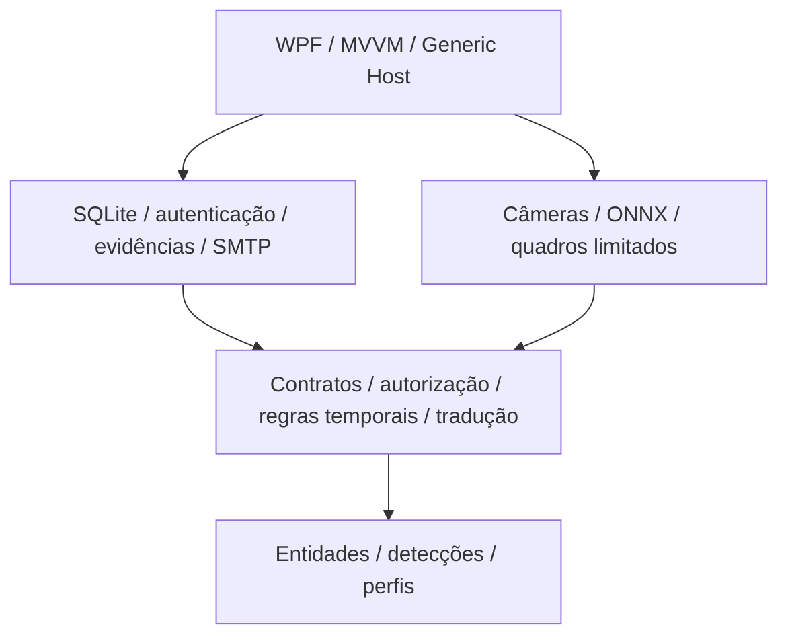

# SurveillanceAI — base do aplicativo Windows

Português (Brasil) | [English](readme.en.md)

Central local em WPF para monitorar câmeras, detectar objetos e revisar eventos. Esta base não prevê crimes, não reconhece agressões e não oferece detector de armas validado. **O monitoramento para quando o aplicativo é fechado.**

## Funcionalidades implementadas

- .NET 10, WPF, MVVM e Generic Host; tema escuro, grade de câmeras, tela cheia e pausa da prévia sem interromper a inferência.
- Criação inicial do administrador, senhas com hash Identity, entrada/saída, alteração de senha, três perfis, ativação e bloqueio por tentativas inválidas.
- SQLite com migrações EF Core, cadastro de câmeras, eventos paginados e filtráveis, revisão, anotações e auditoria. Nenhum incidente fictício é inserido na instalação.
- Captura/inferência em segundo plano, fila de um quadro, descarte/liberação dos antigos, webcam/RTSP/vídeo local, reconexão e cancelamento.
- Inferência ONNX real em CPU com YOLOv8n, manifesto, SHA-256, classes versionadas, validação de tensores e NMS.
- Regras inicialmente desabilitadas, confirmação temporal, associação espacial e intervalo entre alertas. Proximidade é apenas diagnóstico visual opcional.
- Destinatários com filtros, credenciais DPAPI, MailKit, fila persistente, novas tentativas e testes SMTP.
- Imagens opcionais de eventos, retenção, registros JSON configuráveis e métricas medidas.
- Português por padrão, inglês selecionável durante o uso, testes automatizados, integração contínua e publicação Windows independente do runtime instalado.

## Idioma

A interface inicia em **português do Brasil (pt-BR)**, independentemente do Windows. No seletor **Idioma**, disponível antes e depois de entrar, escolha **English** para inglês (en-US). A troca é imediata e não reinicia as câmeras.

A preferência fica em `language.json`, na pasta da instalação, e é restaurada ao abrir. Números e datas seguem o idioma. Identificadores do banco, classes do modelo e valores técnicos permanecem estáveis; sua apresentação é traduzida. Os guias principais estão em português e vinculam versões inglesas. Veja [internacionalização](docs/internationalization.md).

## Arquitetura



Console e modelos originais foram preservados. Os cinco projetos novos não têm dependências circulares. Consulte [arquitetura](docs/architecture.md) e [auditoria](docs/audit.md).

## Compilar e iniciar

Use Windows x64 e SDK .NET 10. O global.json aceita a faixa de recursos mais recente do .NET 10; o Visual Studio precisa ser compatível. A linha de comando funciona separadamente.

```powershell
dotnet restore SurveillanceAI.sln
dotnet build SurveillanceAI.sln
dotnet run --project src/SurveillanceAI.Desktop
```

Nesta máquina, `.tools/dotnet/dotnet.exe` pode substituir dotnet. Esse SDK local é ignorado pelo Git e não faz parte do produto.

A primeira abertura cria e migra `%LOCALAPPDATA%/SurveillanceAI/surveillance.db`. Informe usuário e senha de **12 a 256 caracteres** para criar o administrador e entrar. Não há senha padrão de produção. Apenas um processo usa a mesma pasta por vez.

Defina `SURVEILLANCEAI_DATA` antes de abrir para usar uma pasta local privada fora do repositório. Isso muda banco, evidências, registros e preferência de idioma juntos. Feche antes de copiar a instalação. Credenciais protegidas dependem da conta Windows original.

## Operação

1. **Câmeras:** crie uma câmera com nome, descrição, localização, origem e FPS (1–30). Use 0 para a webcam padrão, caminho completo para vídeo ou URI RTSP. A origem é mascarada/protegida; vazia na edição preserva a anterior. Salve e teste. Habilite/desabilite e salve para iniciar/parar; reaplicar configuração reinicia os trabalhadores configurados.
2. **Visão geral e ao vivo:** acompanhe conexão, vídeo, modelo, FPS, latência, descartes, reconexões e fila. Amplie para tela cheia; Escape retorna. Pausar a prévia mantém a inferência. Nenhuma câmera é cadastrada automaticamente.
3. **Regras de alerta:** use a classe exata do manifesto, confiança, confirmações, janela, IoU, intervalo e severidade. Um ID opcional limita por câmera. Habilite explicitamente. Valores iniciais são exemplos que exigem validação. A classe canônica continua sendo, por exemplo, `person`, mesmo em português.
4. **Eventos:** busque classe/anotações e filtre câmera, datas locais, severidade e revisão. Horários dos eventos são UTC, com formato regional. Páginas têm até 100 registros. Operadores/administradores podem anotar, revisar e marcar falsos positivos; visualizadores não alteram eventos.
5. **Sistema:** valide e ative pacotes locais confiáveis; configure imagens de evidência, retenção e nível dos registros. Evidências ficam em evidence na pasta de dados. Retenção padrão: 30 dias para eventos/imagens e 14 para registros.
6. **Usuários / Minha conta:** gerencie contas ou altere sua senha. Serviços verificam permissões além da visibilidade dos controles.

## Modelos

`onnxmodel/yolov8n.onnx` e manifest.json são publicados em models/legacy. As cópias históricas têm o mesmo SHA-256 e foram preservadas; a publicação desktop não inclui duplicatas ou .pt. Valide um pacote com manifesto/ONNX em Sistema antes de ativar. Não há download automático. Veja o [contrato de modelos](docs/monitoring.md).

Na inspeção do treinamento, a fase 3 exportava um classificador ResNet18, não um detector de objetos; esse manifesto é rejeitado. Um detector futuro exige contrato/validação próprios. Não se afirma detecção de armas nem se altera o repositório de treinamento.

## Notificações por e-mail

Em **Notificações**, salve servidor, porta, TLS, usuário/senha opcionais, remetente e máximo de tentativas. Servidores reais exigem STARTTLS ou TLS ao conectar. O teste local permite SMTP sem criptografia apenas no próprio computador. Cadastre destinatários com filtros de classe/câmera/severidade e habilite o canal explicitamente.

**Testar conexão SMTP salva** conecta/autentica sem enviar. **Enviar e-mail de teste** enfileira uma mensagem mesmo com o canal geral desabilitado. Ambos usam dados salvos. Clique em Atualizar para acompanhar tentativas e erros sem segredos. Notificações normais iniciam desabilitadas e levam metadados, sem anexos de filmagens.

## Testes e publicação

```powershell
dotnet test SurveillanceAI.sln
dotnet publish src/SurveillanceAI.Desktop -c Release -r win-x64 --self-contained true -o artifacts/publish
./scripts/Smoke-Desktop.ps1
```

Testes usam bancos temporários, fontes simuladas, vídeo MJPEG gerado, modelo real em CPU, imagem pública e SMTP local. Não exigem câmera, GPU, conta de e-mail ou rede durante a execução. O teste visual usa dados isolados e câmera desabilitada por padrão; -VideoPath permite vídeo local. A integração contínua compila/testa/publica; o teste visual exige desktop Windows interativo.

Guias: [validação](docs/validation.md), [implantação](docs/deployment.md), [banco](docs/database.md), [segurança](docs/security.md) e [arquivos alterados](docs/changes.md).

## Limitações e próximos passos

- Sem serviço Windows persistente, inicialização automática, watchdog ou garantia contínua.
- IoU não identifica pessoas persistentemente. Acurácia, segurança, falsos positivos e capacidade multicâmera não foram validados operacionalmente.
- Uma sessão local; sem MFA, recuperação de senha, controle por câmera, criptografia independente do banco/evidências ou auditoria inviolável. Proteja conta Windows, disco e dados.
- Evidências acompanham a pasta de dados; não há seletor independente. Alterar câmera/modelo reinicia todos os trabalhadores.
- Drivers nativos podem bloquear apesar do cancelamento; webcam e RTSP reais precisam de testes de campo.
- SMTP é de pelo menos uma entrega: queda após enviar e antes de registrar sucesso pode duplicar a mensagem. Unicidade evento/destinatário não elimina essa janela.
- A limpeza trata evidências registradas, não órfãs após queda de energia. Arquivamento da auditoria, vídeo contínuo, exportação, retenção legal, instalador assinado e atualização automática são futuros.
- O modelo declara AGPL-3.0. Revise pesos, imagem de teste, codecs e dependências antes de comercializar; não se afirma liberação comercial.

Antes do piloto: testes prolongados com hardware, revisão por operadores, validação de modelo/regras, privacidade/licenciamento, recuperação e empacotamento assinado. Host persistente exige testes próprios de ciclo de vida e autorização.

Teste da troca e persistência de idioma: `./scripts/Smoke-Localization.ps1`.
