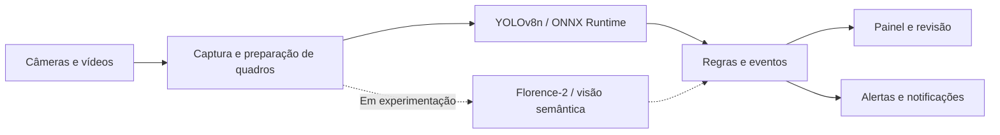

# SurveillanceAI

**Monitoramento inteligente de câmeras com IA local.**

[Português (Brasil)](readme.md) | [English](readme.en.md)

O **SurveillanceAI** é uma aplicação desktop para Windows que reúne captura de vídeo, detecção de objetos por inteligência artificial, regras configuráveis e gestão de eventos em uma única interface. O projeto explora como modelos de visão computacional podem apoiar a identificação de situações de interesse em estabelecimentos, com **inferência no próprio computador** e controle dos dados pelo operador.

O foco atual é combinar a velocidade de detectores tradicionais com a flexibilidade de modelos de visão orientados por linguagem natural, preservando uma experiência simples para quem utiliza o sistema.

## Destaques

- **Monitoramento multicâmera:** webcam, câmeras IP por RTSP, streams HTTP compatíveis e arquivos de vídeo.
- **IA local:** detecção de objetos com YOLOv8n e ONNX Runtime, com processamento em segundo plano e descarte de quadros obsoletos para manter a interface responsiva.
- **Pesquisa em detecção semântica:** integração experimental do Florence-2 para localizar objetos por descrições, incluindo cenários de possíveis armas em imagens de vigilância.
- **Eventos e evidências:** registros pesquisáveis, revisão pelo operador, anotações e marcação de falsos positivos.
- **Alertas e notificações:** regras de monitoramento, controle de intervalo entre eventos e envio de e-mails via SMTP.
- **Aplicação completa:** interface WPF, autenticação e perfis de usuário, configurações persistidas em SQLite, português e inglês, testes automatizados e publicação Windows.

## Como funciona



A captura e a inferência são desacopladas da interface. Os resultados podem incluir **classe do objeto, posição na imagem e informações de processamento**. O projeto também registra métricas como FPS, latência e descarte de quadros para apoiar testes em hardware local.

## Tecnologias principais

| Tecnologia | O que faz | Papel no projeto |
| --- | --- | --- |
| **YOLOv8n — You Only Look Once** | Detecta e localiza objetos em imagens com uma única passagem pela rede. | Reconhecimento rápido de pessoas e objetos das classes conhecidas. |
| **ONNX — Open Neural Network Exchange** | Formato interoperável de modelos de IA. | Permite executar modelos exportados sem depender do ambiente de treinamento. |
| **ONNX Runtime** | Motor de inferência otimizado para modelos ONNX. | Executa a detecção localmente e oferece opções de aceleração compatíveis. |
| **Florence-2** | Modelo fundamental de visão da Microsoft, com tarefas de compreensão e localização visual. | Investigação de detecção orientada por descrições textuais, complementando classes fixas. |
| **Phrase grounding** | Associa uma descrição em linguagem natural a uma região da imagem. | Explora buscas visuais como `handgun` em quadros de vigilância. |
| **Inferência** | Aplicação de um modelo já treinado a uma nova imagem. | Analisa câmeras e vídeos sem exigir treinamento para cada execução. |
| **Bounding box** | Retângulo delimitador de uma região detectada. | Mostra visualmente onde o modelo encontrou um objeto. |
| **NMS — Non-Maximum Suppression** | Remove detecções redundantes sobre um mesmo objeto. | Melhora a apresentação dos resultados do detector. |
| **IoU — Intersection over Union** | Mede a sobreposição entre duas regiões. | Apoia a associação espacial nas regras de monitoramento. |
| **C# / .NET 10 / WPF / MVVM** | Plataforma, interface desktop e organização de apresentação. | Estruturam a aplicação, seus serviços e a experiência do usuário. |
| **SQLite / Entity Framework Core** | Persistência local e acesso a dados. | Guardam câmeras, configurações, eventos e auditoria. |
| **MailKit** | Biblioteca de comunicação por e-mail. | Implementa o canal de notificações SMTP. |

Protocolos de câmera, autenticação, proteção de credenciais e detalhes de implementação estão descritos na [documentação de arquitetura](docs/architecture.md) e nos [guias técnicos](docs/monitoring.md).

## Evolução: templates de monitoramento

Uma das próximas etapas é tornar os alertas tão simples quanto **selecionar quais situações monitorar**, sem exigir que o usuário configure manualmente classes, limiares e parâmetros temporais.

| Template | Ideia |
| --- | --- |
| **Possíveis armas de fogo e simulacros** | Explorar reconhecimento visual independente da identidade ou intenção de quem aparece na imagem. |
| **Facas e objetos cortantes** | Detectar objetos de interesse em áreas monitoradas. |
| **Aglomeração** | Combinar contagem de pessoas com áreas de interesse e evolução temporal. |
| **Pessoas correndo** | Usar deslocamento e acompanhamento entre quadros. |
| **Possível confronto físico** | Investigar padrões de movimento e, quando necessário, estimativa de pose. |
| **Movimento fora do horário** | Combinar monitoramento de áreas e horários configuráveis. |
| **Gritos e pedidos de socorro** | Explorar futuramente modelos locais de análise de áudio. |

A visão é oferecer templates **configuráveis por câmera, área e sensibilidade**, com parâmetros avançados disponíveis apenas quando necessários. Este catálogo representa a direção de desenvolvimento, não uma lista de funcionalidades concluídas.

## Executar localmente

**Requisitos de desenvolvimento:** Windows x64 e SDK do .NET 10.

```powershell
dotnet restore SurveillanceAI.sln
dotnet build SurveillanceAI.sln
dotnet run --project src/SurveillanceAI.Desktop
```

Na primeira execução, o aplicativo cria o banco local em `%LOCALAPPDATA%/SurveillanceAI/` e permite cadastrar o administrador. A configuração de câmeras é feita na própria interface.

Para executar os testes e gerar uma publicação independente do runtime instalado:

```powershell
dotnet test SurveillanceAI.sln
dotnet publish src/SurveillanceAI.Desktop -c Release -r win-x64 --self-contained true -o artifacts/publish
```

## Documentação

- [Arquitetura](docs/architecture.md) e [monitoramento/modelos](docs/monitoring.md)
- [Validação e testes](docs/validation.md)
- [Implantação](docs/deployment.md)
- [Internacionalização](docs/internationalization.md)
- [Segurança e privacidade](docs/security.md)

O SurveillanceAI está em **desenvolvimento ativo**. Novos motores visuais e templates são incorporados e avaliados progressivamente com imagens e vídeos reais. Questões operacionais, requisitos de implantação e condições de licenciamento dos modelos são tratadas na documentação técnica.
